# Wiki.js - Infraestructura como Código, CI/CD y Observabilidad

## Información académica

- **Institución:** Instituto Tecnológico Metropolitano (ITM).
- **Asignatura:** Introducción a Cloud.
- **Docente:** Enrique José González de la Rosa.
- **Actividades:** Actividad 5 y Actividad 6.
- **Temática:** Wikis / Knowledge Bases.
- **Integrantes:**
  - Julián David Agudelo Acevedo.
  - Samuel Osorio Avendaño.

## 1. Descripción del proyecto

El proyecto consiste en la implementación de una plataforma de gestión del conocimiento utilizando Wiki.js, desplegada mediante contenedores Docker sobre infraestructura de Amazon Web Services (AWS).

La solución utiliza PostgreSQL como base de datos relacional y Redis como base de datos en memoria, mediante un servicio complementario desarrollado en Python con Flask que permite registrar y consultar búsquedas recientes.

Durante la Actividad 5 se implementó la infraestructura como código utilizando Terraform, los servicios contenerizados y las bases de datos gestionadas en AWS.

Para la Actividad 6 se complementó la solución mediante la implementación de un estado remoto de Terraform, un pipeline de integración y despliegue continuo con GitHub Actions y mecanismos de observabilidad utilizando Amazon CloudWatch y Amazon SNS.

## 2. Objetivos

- Implementar infraestructura como código mediante Terraform.
- Desplegar aplicaciones utilizando contenedores Docker.
- Utilizar bases de datos gestionadas en AWS.
- Implementar integración y despliegue continuo de infraestructura.
- Gestionar el estado de Terraform de manera remota y segura.
- Implementar mecanismos de monitoreo y alertas.
- Validar la disponibilidad de la aplicación después de un despliegue.

## 3. Tecnologías utilizadas

| Tecnología | Propósito |
|---|---|
| Wiki.js 2.5 | Plataforma de gestión del conocimiento |
| Python y Flask | Servicio complementario de consultas |
| Docker | Contenerización de aplicaciones |
| Docker Compose | Administración de contenedores |
| Terraform | Infraestructura como código |
| Amazon EC2 | Alojamiento de aplicaciones |
| Amazon RDS | Base de datos PostgreSQL gestionada |
| Amazon ElastiCache | Base de datos Redis gestionada |
| Amazon VPC | Infraestructura de red |
| AWS IAM | Administración de identidades y permisos |
| AWS Secrets Manager | Administración de credenciales |
| AWS Systems Manager | Acceso administrativo a EC2 |
| Amazon S3 | Almacenamiento remoto del estado de Terraform |
| GitHub Actions | Integración y despliegue continuo |
| OpenID Connect (OIDC) | Autenticación entre GitHub y AWS |
| Amazon CloudWatch | Monitoreo y observabilidad |
| Amazon SNS | Notificaciones por correo electrónico |

## 4. Arquitectura de la solución

La infraestructura se encuentra desplegada en la región us-east-2 (Ohio) de AWS.

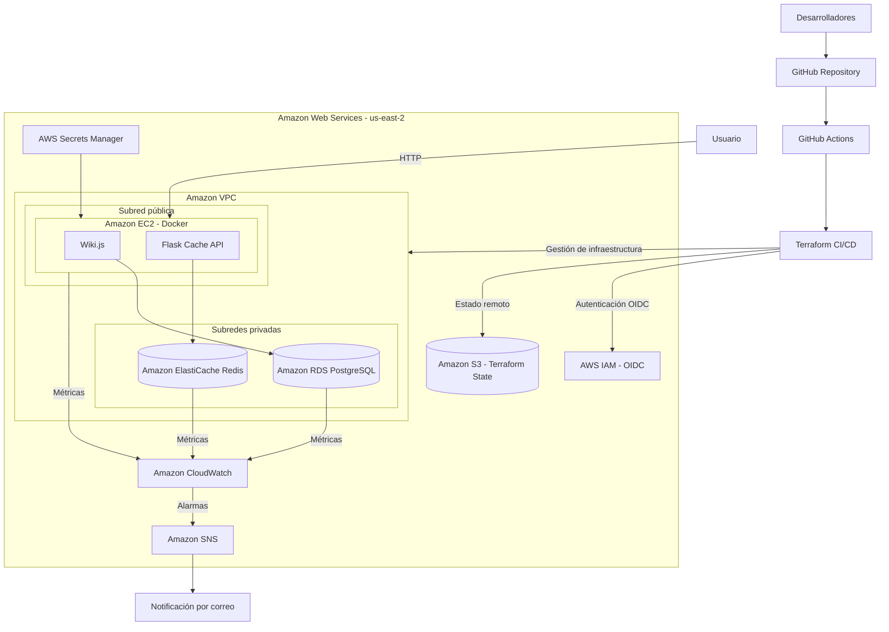

### 4.1. Componentes de infraestructura

| Componente | Configuración |
|---|---|
| Región AWS | us-east-2 |
| Zona de disponibilidad EC2 | us-east-2a |
| Instancia EC2 | wikijs-actividad5-ec2 |
| Tipo de instancia EC2 | t3.small |
| Sistema operativo | Linux |
| Base de datos relacional | PostgreSQL 15 |
| Instancia RDS | db.t3.micro |
| Base de datos en memoria | Redis OSS 7 |
| Nodo ElastiCache | cache.t4g.micro |
| Almacenamiento EC2 | gp3, 16 GB, cifrado |
| Puerto público Wiki.js | 80 |
| Puerto interno Flask | 5000 |
| Puerto PostgreSQL | 5432 |
| Puerto Redis | 6379 |

## 5. Estructura del repositorio

```text
iacode-wikijs-actividad5/
├── .github/
│   └── workflows/
│       └── terraform.yml
├── evidencias/
├── evidencias_actividad6/
├── services/
│   └── cache-api/
│       ├── Dockerfile
│       ├── app.py
│       └── requirements.txt
├── terraform/
│   ├── modules/
│   │   ├── containers/
│   │   │   ├── scripts/
│   │   │   │   └── user_data.sh
│   │   │   ├── main.tf
│   │   │   ├── outputs.tf
│   │   │   └── variables.tf
│   │   ├── database/
│   │   │   ├── main.tf
│   │   │   ├── outputs.tf
│   │   │   └── variables.tf
│   │   └── networking/
│   │       ├── main.tf
│   │       ├── outputs.tf
│   │       └── variables.tf
│   ├── .terraform.lock.hcl
│   ├── backend.tf
│   ├── main.tf
│   ├── outputs.tf
│   ├── providers.tf
│   ├── terraform.tfvars.example
│   ├── variables.tf
│   └── versions.tf
├── .env.aws.example
├── .gitignore
├── compose.aws.yaml
├── compose.yaml
└── README.md
```

## 6. Actividad 5 - Infraestructura como código y contenedores

### 6.1. Implementación local

Inicialmente se realizó una implementación local utilizando Docker Compose para validar el funcionamiento de los servicios antes de desplegarlos en AWS.

Los servicios utilizados fueron:

- Wiki.js.
- PostgreSQL.
- Redis.
- API de consultas desarrollada con Flask.

Esta implementación permitió comprobar el funcionamiento de Wiki.js, la creación de páginas y el almacenamiento y recuperación de consultas mediante Redis.

### 6.2. Infraestructura como código

La infraestructura se implementó utilizando Terraform y se organizó mediante tres módulos.

| Módulo | Responsabilidad |
|---|---|
| networking | VPC, subredes, tablas de enrutamiento y grupos de seguridad |
| database | Amazon RDS PostgreSQL y Amazon ElastiCache Redis |
| containers | Instancia EC2, roles IAM y configuración de contenedores |

La modularización permite separar las responsabilidades de cada componente y facilita el mantenimiento de la infraestructura.

### 6.3. Despliegue en AWS

La aplicación Wiki.js y el servicio Flask se ejecutan mediante contenedores Docker dentro de una instancia EC2.

A diferencia de la implementación local, las bases de datos no se ejecutan dentro de contenedores, sino que se utilizan servicios gestionados de AWS:

- Amazon RDS para PostgreSQL.
- Amazon ElastiCache para Redis.

Las bases de datos se encuentran dentro de subredes privadas y no requieren exposición directa a Internet.

### 6.4. Servicio complementario de Redis

Se desarrolló una API utilizando Python y Flask para demostrar el uso de una base de datos en memoria.

El servicio permite registrar y consultar búsquedas recientes.

| Método | Endpoint | Descripción |
|---|---|---|
| GET | /consultas | Consultar las búsquedas registradas |
| POST | /consultas | Registrar una nueva búsqueda |

Ejemplo de registro de una consulta desde EC2:

```bash
curl -sS -X POST http://127.0.0.1:5000/consultas \
  -H "Content-Type: application/json" \
  -d '{"consulta":"Prueba de Redis en AWS - Actividad 5"}'
```

Ejemplo de consulta:

```bash
curl -sS http://127.0.0.1:5000/consultas
```

Resultado obtenido durante las pruebas:

```json
{
  "consultas_recientes": [
    "Prueba de Redis en AWS - Actividad 5"
  ],
  "total": 1
}
```

La API se encuentra disponible únicamente mediante la interfaz local de EC2, evitando su exposición pública.

### 6.5. Resultado de la implementación

Se logró desplegar correctamente Wiki.js en AWS, establecer la conexión con PostgreSQL y validar el funcionamiento del servicio complementario con Redis.

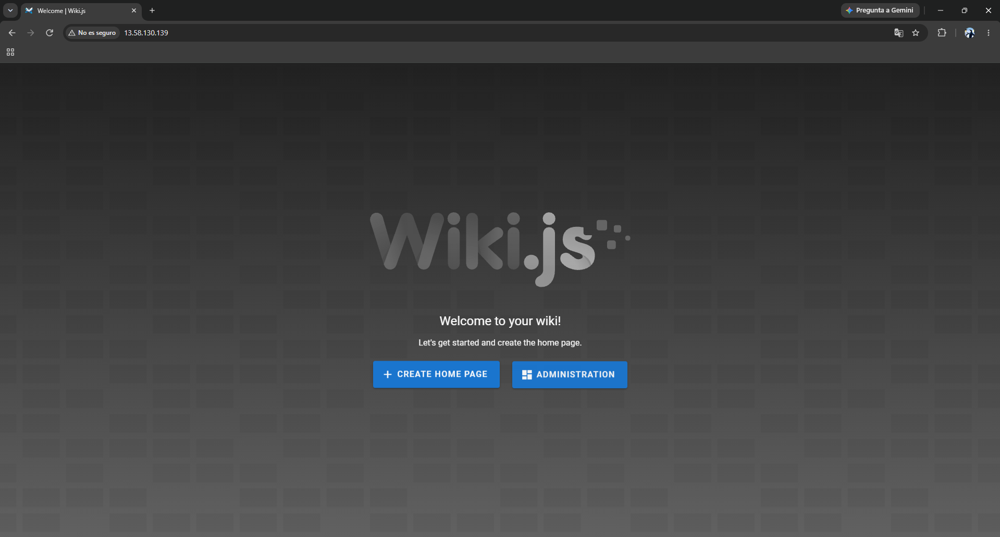

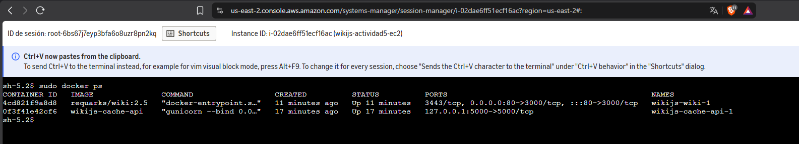

## 7. Actividad 6 - CI/CD y Observabilidad

Para esta actividad se tomó como base la infraestructura implementada durante la Actividad 5.

Se seleccionó la opción de integración y despliegue continuo de infraestructura como código utilizando GitHub Actions y Terraform.

### 7.1. Estado remoto de Terraform

Inicialmente, Terraform administraba el estado de la infraestructura de manera local.

Para permitir la ejecución desde GitHub Actions se migró el estado a un bucket de Amazon S3.

La configuración implementada incluye:

- Almacenamiento remoto del estado.
- Versionamiento de objetos.
- Bloqueo de acceso público.
- Permisos de acceso mediante IAM.
- Bloqueo del estado mediante archivos de bloqueo de S3.

El backend remoto se encuentra definido en:

`terraform/backend.tf`

La migración permitió que las ejecuciones locales y las ejecuciones desde GitHub Actions utilizaran el mismo estado de infraestructura.

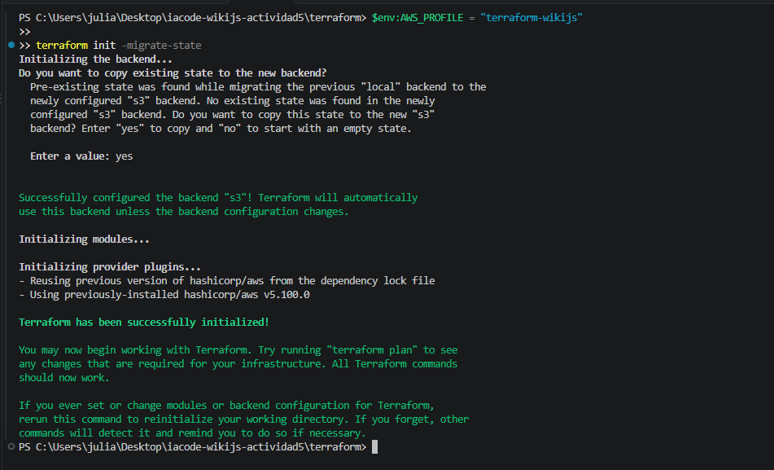

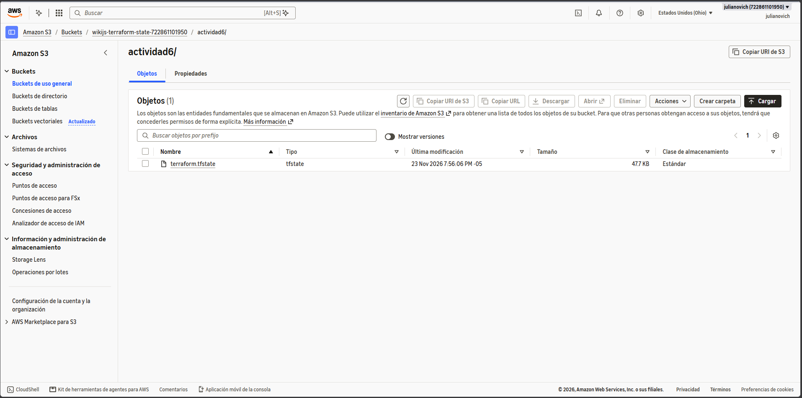

### 7.2. Autenticación mediante OIDC

Se configuró un proveedor de identidad OpenID Connect en AWS para permitir que GitHub Actions obtuviera credenciales temporales.

Se creó el rol:

`GitHubActions-WikiJS-Actividad6-Role`

La política de confianza restringe la autenticación al repositorio autorizado y a la rama main.

Esta configuración evita almacenar credenciales permanentes de AWS dentro del repositorio o en los secretos de GitHub.

Los permisos del rol fueron configurados siguiendo el principio de mínimo privilegio.

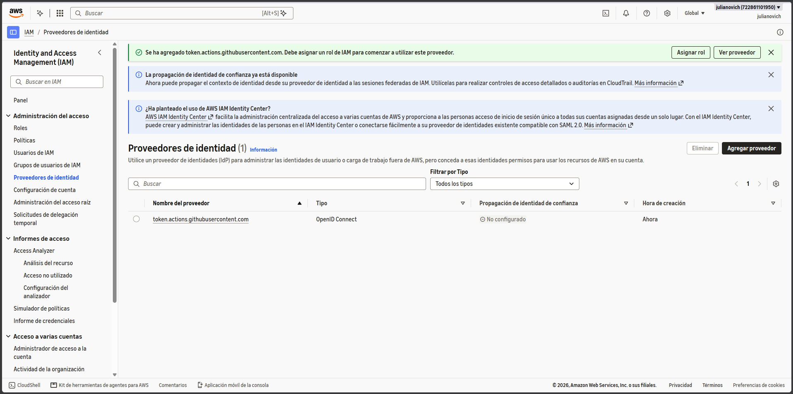

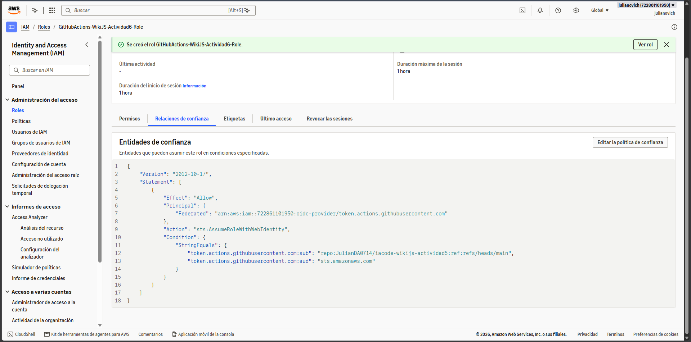

### 7.3. Pipeline de integración y despliegue continuo

El pipeline se encuentra definido en:

`.github/workflows/terraform.yml`

Se configuraron dos mecanismos de ejecución:

- Ejecución automática cuando se realizan cambios en Terraform o en el workflow sobre la rama main.
- Ejecución manual mediante workflow_dispatch, con la posibilidad de autorizar Terraform Apply.

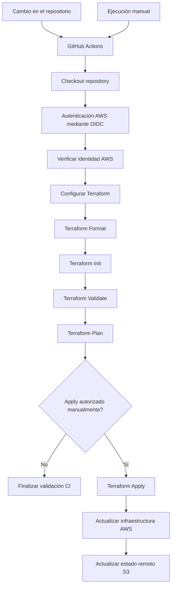

### 7.4. Etapas del pipeline

| Etapa | Descripción |
|---|---|
| Checkout repository | Obtener el código fuente |
| Configure AWS credentials | Autenticarse en AWS mediante OIDC |
| Verify AWS identity | Validar la identidad utilizada |
| Setup Terraform | Configurar Terraform |
| Terraform Format | Verificar el formato de los archivos |
| Terraform Init | Inicializar módulos, proveedores y backend |
| Terraform Validate | Validar la configuración |
| Terraform Plan | Identificar los cambios de infraestructura |
| Terraform Apply | Aplicar el plan cuando existe autorización manual |

La etapa Terraform Apply se ejecuta únicamente cuando se inicia manualmente el workflow desde la rama main y se habilita la opción de despliegue.

De esta manera, los cambios enviados al repositorio se validan automáticamente sin aplicar modificaciones de infraestructura de manera automática.

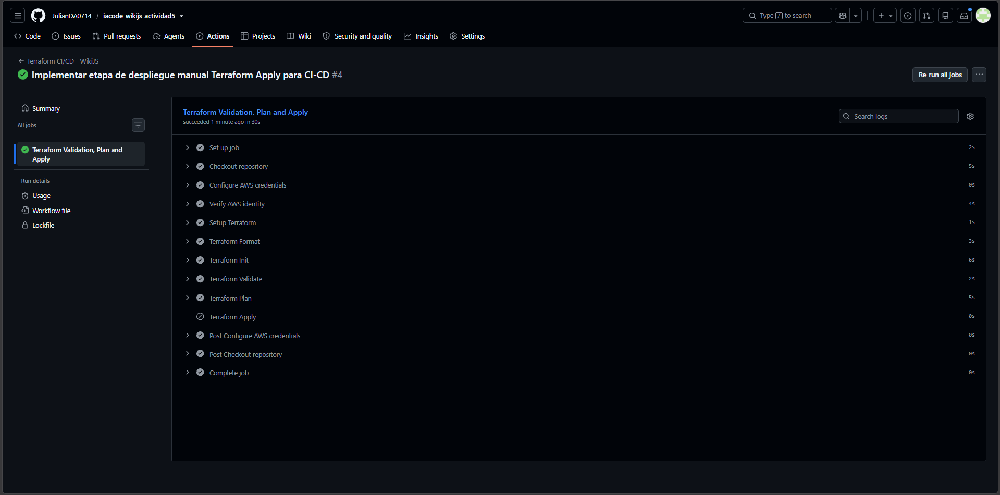

### 7.5. Despliegue controlado de infraestructura

Para demostrar el funcionamiento real del despliegue continuo se realizó una modificación controlada sobre la instancia EC2 existente.

Se agregó la siguiente etiqueta mediante Terraform:

```hcl
tags = {
  Name     = "${var.project_name}-ec2"
  Activity = "Actividad6"
}
```

Antes de realizar el despliegue se validó que el plan únicamente incluyera la modificación de las etiquetas.

Resultado del plan:

```text
Plan: 0 to add, 1 to change, 0 to destroy.
```

Posteriormente, se ejecutó manualmente el pipeline autorizando Terraform Apply.

Resultado del despliegue:

```text
Apply complete! Resources: 0 added, 1 changed, 0 destroyed.
```

La ejecución número 7 del pipeline finalizó exitosamente en 34 segundos.

La modificación de la instancia EC2 se completó en aproximadamente 2 segundos.

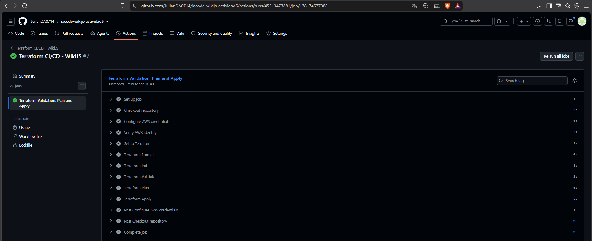

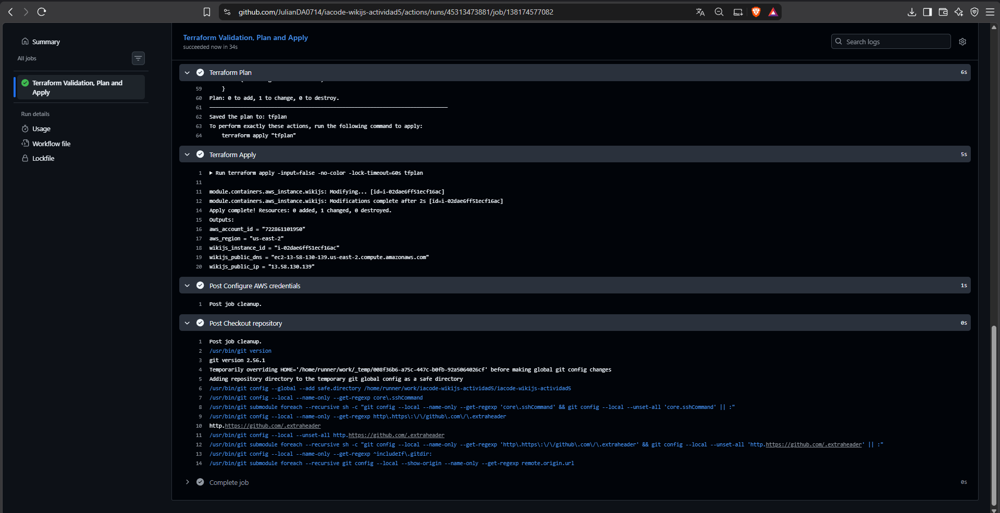

### 7.6. Validación posterior al despliegue

Después de ejecutar Terraform Apply se realizaron las siguientes verificaciones:

- La etiqueta Activity se agregó correctamente.
- La instancia EC2 conservó su identificador.
- La dirección IP pública permaneció sin cambios.
- El DNS público permaneció sin cambios.
- La instancia continuó en ejecución.
- Las tres comprobaciones de estado de EC2 fueron aprobadas.
- Wiki.js continuó disponible.

Finalmente, se ejecutó Terraform Plan desde el entorno local.

Resultado:

```text
No changes. Your infrastructure matches the configuration.
```

Este resultado permitió comprobar que el estado remoto se encontraba actualizado y que no existían cambios adicionales pendientes según la configuración vigente de Terraform.

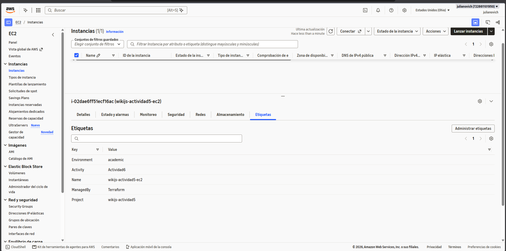

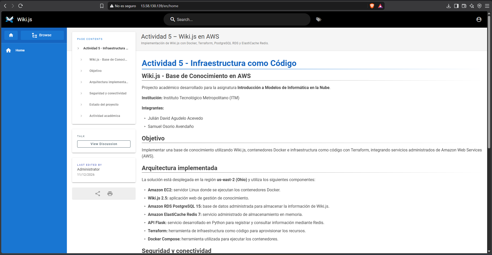

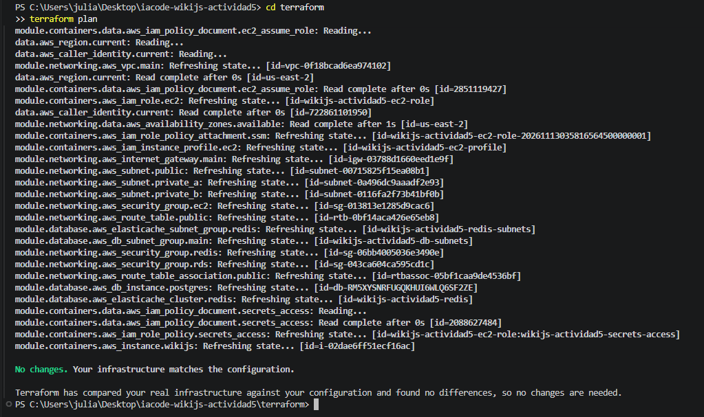

## 8. Observabilidad

### 8.1. Amazon CloudWatch

Se implementó un dashboard denominado:

`WikiJS-Actividad6-Monitoring`

El dashboard permite visualizar el comportamiento de los principales componentes de la infraestructura mediante métricas de utilización de CPU.

Los servicios monitoreados son:

- Amazon EC2.
- Amazon RDS.
- Amazon ElastiCache.

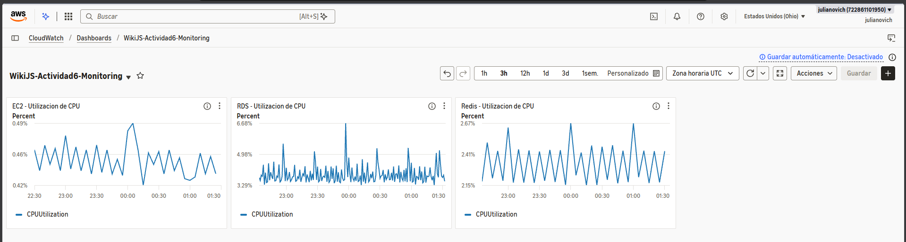

### 8.2. Configuración de alarmas

Se configuraron tres alarmas de CloudWatch.

| Alarma | Servicio | Métrica | Umbral |
|---|---|---|---|
| WikiJS-EC2-HighCPU | EC2 | CPUUtilization | >= 80% |
| WikiJS-RDS-HighCPU | RDS | CPUUtilization | >= 80% |
| WikiJS-Redis-HighCPU | ElastiCache | CPUUtilization | >= 80% |

Las alarmas fueron configuradas con las siguientes características:

- Estadística: promedio.
- Periodo de evaluación: 5 minutos.
- Puntos de datos necesarios: 1 de 1.
- Umbral estático.
- Notificación cuando la alarma cambia al estado ALARM.

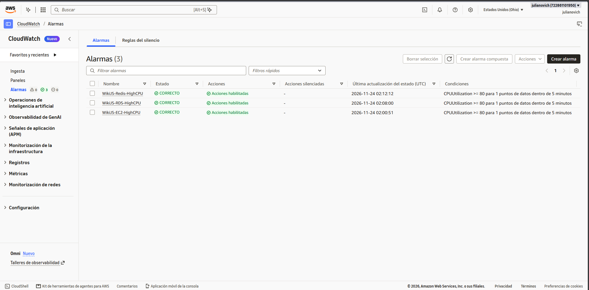

### 8.3. Notificaciones mediante Amazon SNS

Se creó un tema de Amazon SNS denominado:

`WikiJS-Actividad6-Alertas`

Este tema se encuentra asociado a las tres alarmas de CloudWatch y permite enviar notificaciones por correo electrónico cuando alguna de ellas cambia al estado ALARM.

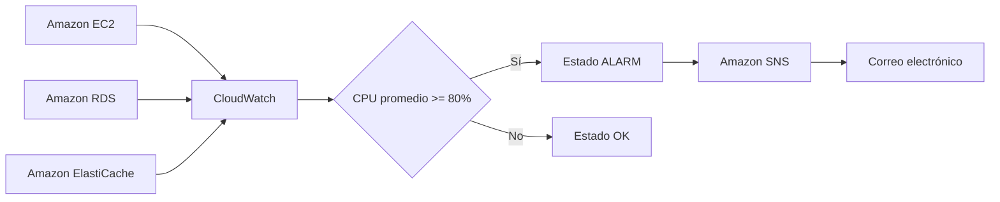

### 8.4. Prueba controlada de notificaciones

Para comprobar el funcionamiento de las notificaciones sin generar una sobrecarga real sobre la infraestructura, se realizó una simulación controlada utilizando AWS CloudShell.

```bash
aws cloudwatch set-alarm-state \
  --alarm-name "WikiJS-EC2-HighCPU" \
  --state-value ALARM \
  --state-reason "Prueba controlada de notificaciones SNS - Actividad 6" \
  --region us-east-2
```

La prueba permitió comprobar:

- El cambio temporal de estado de la alarma.
- La ejecución de la acción configurada.
- La recepción de la notificación por correo electrónico.
- El restablecimiento automático de la alarma al estado OK después de evaluar nuevamente las métricas reales.

Esta prueba no generó una sobrecarga real de CPU ni modificó los recursos de infraestructura.

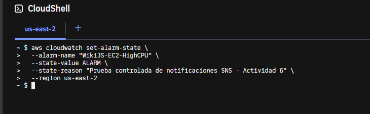

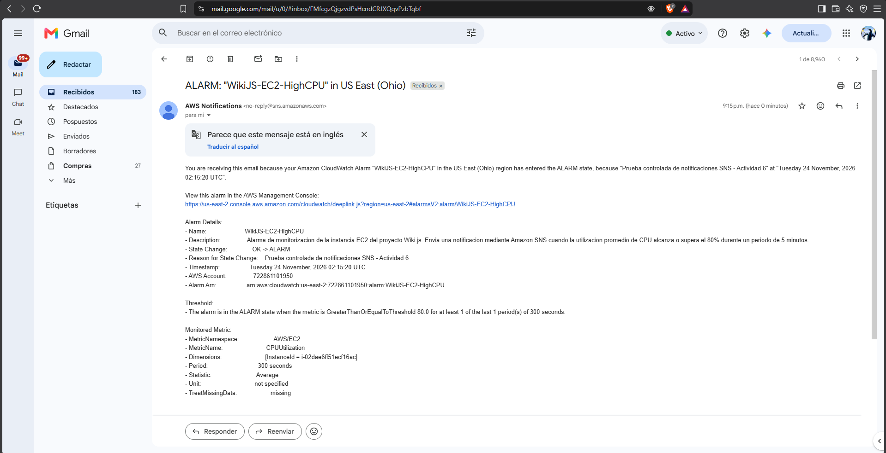

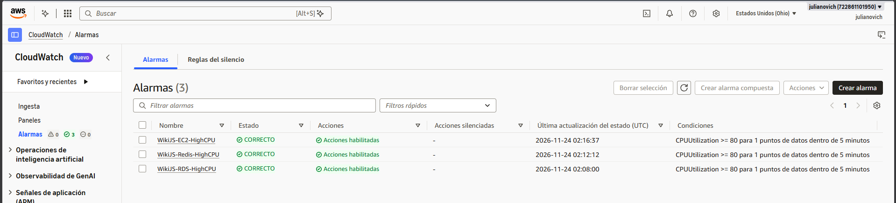

El dashboard, las alarmas y el tema SNS fueron configurados desde la consola de AWS y no forman parte de los recursos administrados actualmente por Terraform.

## 9. Seguridad

Durante la implementación se tuvieron en cuenta las siguientes configuraciones:

- Bases de datos ubicadas en subredes privadas.
- Grupos de seguridad para controlar el acceso entre servicios.
- Credenciales de PostgreSQL administradas mediante AWS Secrets Manager.
- Conexión cifrada mediante SSL hacia PostgreSQL.
- Volumen de almacenamiento EC2 cifrado.
- Acceso administrativo mediante AWS Systems Manager.
- Ausencia de exposición pública del puerto SSH.
- Autenticación mediante OIDC para GitHub Actions.
- Permisos IAM restringidos.
- Bloqueo de acceso público al bucket de estado remoto.
- Versionamiento del estado de Terraform.
- Exclusión de archivos sensibles mediante .gitignore.
- Autorización manual para ejecutar Terraform Apply.

## 10. Problemas encontrados y soluciones

### 10.1. Incompatibilidad de Docker Buildx

Durante el despliegue inicial en AWS se presentó una incompatibilidad entre la versión instalada de Docker Buildx y la versión requerida por Docker Compose.

Se solucionó actualizando Docker Buildx a la versión 0.20.1 y ajustando el script de inicialización de la instancia.

### 10.2. Conexión SSL con PostgreSQL

Durante la configuración inicial de Wiki.js se presentaron inconvenientes relacionados con la conexión hacia Amazon RDS.

Se habilitó la conexión SSL y se incorporó el certificado de confianza proporcionado por AWS.

Esto permitió establecer correctamente la conexión entre Wiki.js y PostgreSQL.

### 10.3. Error de autenticación OIDC

Durante las primeras ejecuciones de GitHub Actions se presentó un error al intentar asumir el rol IAM mediante OIDC.

Se realizó una validación temporal de los atributos del token generado por GitHub Actions y se identificó que el atributo subject incluía identificadores inmutables del propietario y del repositorio.

Se ajustó la política de confianza del rol IAM para que coincidiera con el atributo real del token.

Después de validar la autenticación, se eliminó la etapa temporal de diagnóstico del workflow.

### 10.4. Cambios pendientes en el script user_data

Durante la ejecución de Terraform Plan se identificó una modificación pendiente sobre el script de inicialización de EC2, relacionada con los ajustes realizados durante la Actividad 5.

Aplicar directamente este cambio podía ocasionar una interrupción del servicio o una modificación de la dirección IP pública.

Para realizar una prueba de despliegue controlada se incorporó temporalmente la siguiente configuración:

```hcl
lifecycle {
  ignore_changes = [user_data]
}
```

Esto permitió conservar la instancia existente y realizar únicamente la modificación de la etiqueta Activity.

Esta configuración no elimina la diferencia existente en user_data, sino que indica a Terraform que ignore sus modificaciones sobre la instancia existente.

En caso de requerir una actualización futura del script de inicialización, se deberá revisar esta configuración y planificar el cambio correspondiente.

### 10.5. Permisos para Terraform Apply

Inicialmente, el rol de GitHub Actions disponía principalmente de permisos de lectura para realizar las validaciones de Terraform.

Para demostrar el despliegue real se ampliaron de manera controlada los permisos, autorizando:

- La actualización del objeto de estado remoto en S3.
- La creación de la etiqueta Activity con el valor Actividad6 sobre la instancia EC2 existente.

No se otorgaron permisos generales para crear, detener o eliminar instancias EC2.

## 11. Instrucciones de ejecución

### 11.1. Requisitos

- Git.
- Docker y Docker Compose.
- Terraform.
- Cuenta de AWS.
- Credenciales o sesión AWS autorizada.
- Permisos IAM correspondientes.

### 11.2. Clonar el repositorio

```bash
git clone https://github.com/JulianDA0714/iacode-wikijs-actividad5.git
cd iacode-wikijs-actividad5
```

### 11.3. Ejecución local con Docker

Configurar previamente las variables de entorno requeridas por Docker Compose.

```bash
docker compose up -d --build
```

Consultar los contenedores:

```bash
docker compose ps
```

### 11.4. Validar infraestructura Terraform

```bash
cd terraform
terraform init
terraform fmt -check -recursive
terraform validate
terraform plan
```

El backend remoto existente requiere acceso autorizado al bucket de S3.

Para reproducir el proyecto en otra cuenta de AWS se deben configurar previamente los recursos del backend, las variables correspondientes, los permisos IAM y los valores específicos de la cuenta.

### 11.5. Ejecutar el pipeline

1. Ingresar al repositorio de GitHub.
2. Seleccionar la pestaña Actions.
3. Seleccionar Terraform CI/CD - WikiJS.
4. Presionar Run workflow.
5. Seleccionar la rama main.
6. Mantener deshabilitada la opción Apply para realizar únicamente validaciones.
7. Habilitar Apply solamente cuando exista autorización y se haya revisado el cambio previsto.
8. Ejecutar el workflow.

El pipeline genera un nuevo plan en cada ejecución y aplica el archivo de plan generado durante esa misma ejecución cuando se autoriza el despliegue.

El rol IAM actual está limitado a las operaciones autorizadas para la prueba controlada y no permite aprovisionar toda la infraestructura desde cero.

## 12. Evidencias - Actividad 5

| Nº | Descripción | Evidencia |
|---|---|---|
| 01 | Instalación local de Wiki.js | [Ver imagen](evidencias/01_instalacion_wikijs.png) |
| 02 | Inicio de sesión en Wiki.js | [Ver imagen](evidencias/02_login_wikijs.png) |
| 03 | Página publicada localmente | [Ver imagen](evidencias/03_wikijs_pagina_publicada.png) |
| 04 | Contenedores Docker | [Ver imagen](evidencias/04_docker_contenedores.png) |
| 05 | Cuatro contenedores en ejecución | [Ver imagen](evidencias/05_docker_cuatro_contenedores.png) |
| 06 | Consultas mediante Redis | [Ver imagen](evidencias/06_redis_consultas.png) |
| 07 | Wiki.js funcionando en AWS | [Ver imagen](evidencias/07_wikijs_aws_funcionando.png) |
| 08 | Editor de Wiki.js en AWS | [Ver imagen](evidencias/08_wikijs_aws_editor.png) |
| 09 | Página publicada en AWS | [Ver imagen](evidencias/09_wikijs_aws_pagina_publicada.png) |
| 10 | Pruebas de Redis en AWS | [Ver imagen](evidencias/10_redis_aws_pruebas.png) |
| 11 | Lectura de consultas Redis | [Ver imagen](evidencias/11_redis_aws_lectura.png) |
| 12 | Instancia Amazon EC2 | [Ver imagen](evidencias/12_aws_ec2_instancia.png) |
| 13 | Amazon RDS PostgreSQL | [Ver imagen](evidencias/13_aws_rds_postgresql.png) |
| 14 | Amazon ElastiCache Redis | [Ver imagen](evidencias/14_aws_elasticache_redis.png) |
| 15 | Contenedores Docker en AWS | [Ver imagen](evidencias/15_aws_docker_contenedores.png) |
| 16 | Outputs de Terraform | [Ver imagen](evidencias/16_terraform_outputs_aws.png) |
| 17 | Recursos administrados por Terraform | [Ver imagen](evidencias/17_terraform_recursos_aws.png) |

## 13. Evidencias - Actividad 6

| Nº | Descripción | Evidencia |
|---|---|---|
| 01 | Permisos IAM iniciales | [Ver imagen](evidencias_actividad6/01_iam_permisos_actividad6.png) |
| 02 | Versionamiento del bucket S3 | [Ver imagen](evidencias_actividad6/02_s3_bucket_versionamiento.png) |
| 03 | Bloqueo de acceso público S3 | [Ver imagen](evidencias_actividad6/03_s3_bloqueo_acceso_publico.png) |
| 04 | Migración del estado Terraform | [Ver imagen](evidencias_actividad6/04_terraform_migracion_estado_s3.png) |
| 05 | Estado remoto en S3 | [Ver imagen](evidencias_actividad6/05_s3_estado_remoto_terraform.png) |
| 06 | Proveedor OIDC de GitHub | [Ver imagen](evidencias_actividad6/06_iam_proveedor_oidc_github.png) |
| 07 | Rol IAM de GitHub Actions | [Ver imagen](evidencias_actividad6/07_iam_rol_github_actions.png) |
| 08 | Pipeline inicial exitoso | [Ver imagen](evidencias_actividad6/08_github_actions_pipeline_exitoso.png) |
| 09 | Terraform Plan desde GitHub Actions | [Ver imagen](evidencias_actividad6/09_github_actions_terraform_plan.png) |
| 10 | Pipeline definitivo de CI | [Ver imagen](evidencias_actividad6/10_github_actions_pipeline_definitivo.png) |
| 11 | Dashboard de CloudWatch | [Ver imagen](evidencias_actividad6/11_cloudwatch_dashboard_monitorizacion.png) |
| 12 | Alarma CPU EC2 | [Ver imagen](evidencias_actividad6/12_cloudwatch_alarma_cpu_ec2.png) |
| 13 | Alarma CPU RDS | [Ver imagen](evidencias_actividad6/13_cloudwatch_alarma_cpu_rds.png) |
| 14 | Alarma CPU Redis | [Ver imagen](evidencias_actividad6/14_cloudwatch_alarma_cpu_redis.png) |
| 15 | Alarmas consolidadas | [Ver imagen](evidencias_actividad6/15_cloudwatch_alarmas_consolidadas.png) |
| 16 | Simulación de alarma | [Ver imagen](evidencias_actividad6/16_cloudwatch_simulacion_alarma.png) |
| 17 | Notificación SNS por correo | [Ver imagen](evidencias_actividad6/17_sns_notificacion_correo.png) |
| 18 | Restablecimiento de alarma | [Ver imagen](evidencias_actividad6/18_cloudwatch_restablecimiento_alarma.png) |
| 19 | Pipeline CI/CD | [Ver imagen](evidencias_actividad6/19_github_actions_pipeline_ci_cd.png) |
| 20 | Configuración del despliegue manual | [Ver imagen](evidencias_actividad6/20_github_actions_despliegue_manual.png) |
| 21 | Ejecución manual exitosa sin Apply | [Ver imagen](evidencias_actividad6/21_github_actions_ejecucion_manual_exitosa.png) |
| 22 | Permisos de despliegue controlado | [Ver imagen](evidencias_actividad6/22_iam_permisos_despliegue_controlado.png) |
| 23 | Plan de despliegue controlado | [Ver imagen](evidencias_actividad6/23_github_actions_plan_despliegue_controlado.png) |
| 24 | Pipeline CD exitoso | [Ver imagen](evidencias_actividad6/24_github_actions_pipeline_cd_exitoso.png) |
| 25 | Terraform Apply exitoso | [Ver imagen](evidencias_actividad6/25_github_actions_terraform_apply_exitoso.png) |
| 26 | Etiqueta desplegada en EC2 | [Ver imagen](evidencias_actividad6/26_ec2_etiqueta_desplegada_ci_cd.png) |
| 27 | Disponibilidad de Wiki.js | [Ver imagen](evidencias_actividad6/27_wikijs_disponibilidad_post_despliegue.png) |
| 28 | Terraform Plan final sin cambios | [Ver imagen](evidencias_actividad6/28_terraform_plan_final_sin_cambios.png) |

## 14. Resultados finales

| Requisito | Resultado |
|---|---|
| Infraestructura como código | Completado |
| Aplicaciones contenerizadas | Completado |
| Base de datos relacional gestionada | Completado |
| Base de datos en memoria gestionada | Completado |
| Estado remoto de Terraform | Completado |
| Autenticación mediante OIDC | Completado |
| Integración continua | Completado |
| Despliegue continuo con autorización manual | Completado |
| Despliegue real de infraestructura | Completado |
| Dashboard de observabilidad | Completado |
| Alarmas de monitoreo | Completado |
| Notificaciones por correo | Completado |
| Validación posterior al despliegue | Completado |
| Evidencias Actividad 5 | 17 |
| Evidencias Actividad 6 | 28 |
| Total de evidencias | 45 |

## 15. Limitaciones y mejoras futuras

Debido al alcance académico del proyecto, se identificaron las siguientes oportunidades de mejora:

- Implementar HTTPS mediante certificados TLS.
- Implementar una dirección IP pública estática o un dominio.
- Configurar cifrado en tránsito y en reposo para Redis.
- Administrar el dashboard, las alarmas y SNS mediante Terraform.
- Incorporar métricas de memoria, almacenamiento y disponibilidad HTTP.
- Implementar centralización de logs de los contenedores.
- Incorporar una revisión y aprobación del plan exacto antes del despliegue.
- Revisar la configuración temporal de ignore_changes para user_data.
- Implementar mecanismos de alta disponibilidad.
- Incorporar mecanismos adicionales de control de costos.

Los recursos de AWS utilizados pueden generar costos mientras permanezcan activos.

## 16. Conclusiones

Durante el desarrollo de las actividades 5 y 6 se logró implementar una solución de gestión del conocimiento utilizando diferentes servicios de computación en la nube.

Terraform permitió definir y organizar la infraestructura mediante código, mientras que Docker facilitó la ejecución de las aplicaciones dentro de contenedores.

La utilización de Amazon RDS y Amazon ElastiCache permitió integrar bases de datos gestionadas, evitando administrar directamente estos servicios dentro de la instancia EC2.

La implementación de GitHub Actions permitió automatizar las validaciones de infraestructura y realizar un despliegue real mediante Terraform Apply, utilizando autenticación segura mediante OIDC.

Adicionalmente, CloudWatch y Amazon SNS permitieron implementar mecanismos de observabilidad, monitoreo y notificación de eventos.

Finalmente, se comprobó que el despliegue controlado modificó correctamente la infraestructura, que Wiki.js continuó disponible y que Terraform no presentó cambios adicionales pendientes según su configuración actual.

Este proyecto permitió aplicar de manera práctica los conceptos de infraestructura como código, contenerización, servicios gestionados, CI/CD y observabilidad estudiados durante la asignatura Introducción a Cloud.
